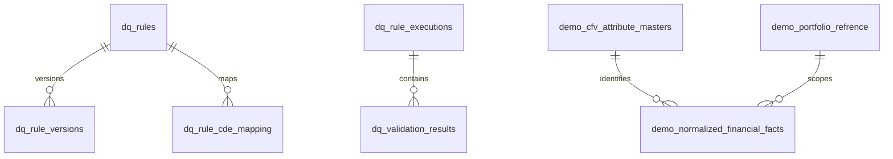

# Solution design and integration boundaries

## Independent applications

| Package/service | Responsibility | Interface |
|---|---|---|
| `api/` | Rule/attribute/portfolio management, orchestration endpoints, reports | FastAPI REST |
| `ui/` | Business rule builder, rule catalog, monitoring dashboard | HTTP calls to API |
| `common/` | Rule schema, validation engine, DB models, reporting, shared business logic | Shared Python package imported by services |
| `worker/` | Asynchronous validations, recurring schedule dispatcher | Celery queue + SQLAlchemy |
| PostgreSQL | DQ metadata, execution history, result persistence | SQLAlchemy |
| Redis | Celery broker and task result backend | Celery protocol |

## Demo DQ relational model

- A `dq_rule_versions` record snapshots the target list, portfolio list and JSON threshold definition. Older versions are never overwritten.
- `dq_validation_results` embeds the version/config/CDE status used at runtime so that changing the master classification does not rewrite history.
- One rule may map to many PRJ IDs; the same PRJ ID may belong to many rules. Operands for cross-CDE comparisons use `role=OPERAND`.
- A disabled CDE is skipped at execution even if the rule remains active.
- Execution status (`COMPLETED`) is distinct from validation result (`FAIL`).

## Extension plan (production)

1. Inspect real schemas, document lineage keys and AR/non-AR/CFI crosswalks. Create approved read-only SQL views with stable logical facts, rather than guessing columns of `prj_financials_v2`.
2. Connect a source adapter returning a typed row set or SQLAlchemy selectable. Separate source DB access credentials from DQ metadata write credentials.
3. Replace demo representations with mapped views; do not call `create_all()` on production tables. Apply reviewed Alembic migrations in a dedicated DQ schema.
4. Push mandatory, duplicate, limit, and reconciliation operations into parameterized SQL for scale. Use an immutable snapshot ID for each execution.
5. Add optional Great Expectations runner: compile compatible rule versions into an expectation suite, execute GX on an authorized SQL batch, then normalize GX validation outputs into `dq_validation_results` under the same execution ID. Keep custom SQL/Python handlers for complex movement/reconciliation.
6. Implement full SSO/OIDC and RBAC, dual-control approvals, scheduled mailer, safe SQL expression DSL, supervised Celery workers, job cancellation, retry/idempotency, and monitoring.
7. Expand Excel import to handle real unstructured workbook headings and repeat column labels, optionally generating AI-assisted **drafts** that always require approval.

## Known semantics to confirm with business

- `ABOVE 100%`, `BELOW 110%`, `NOT BELOW 7%`: these may describe expected PASS conditions or FAIL triggers. In MVP, `LIMIT` is a PASS condition.
- `Movement > 50%`: in MVP this is a FAIL trigger when the magnitude of signed movement is above 50%; `direction` changes the movement metric.
- `PREVIOUS_PERIOD` defaults to previous calendar year. Validate reporting calendars (monthly, quarterly, annual) and restatements before production use.
- Rules with no matching rows return `NOT_APPLICABLE` rather than falsely reporting PASS.
- A rule requiring multiple operands is skipped if a required operand is not a current CDE.

## Production security warnings

Local Compose credentials are public sample values. Use secrets instead; enforce strict API roles, row/portfolio entitlements, rate limiting, query timeouts, audit logging, TLS, read-only source credentials, and approved SMTP/Graph account. Free-form SQL rule execution is intentionally absent.
