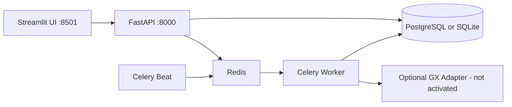

# Financial DQ Control Center — runnable MVP

An isolated, working prototype for the enterprise financial-DQ requirements. **This is not a production banking integration.** No existing enterprise tables or document pipeline are modified.

## Architecture



Separate `api/`, `ui/`, `common/`, and `worker/` Python packages communicate via REST, SQLAlchemy database sessions and Celery tasks. `common/` is importable by both API and worker, keeping calculation semantics in one place.

## Option A: Docker Compose (recommended)

Prerequisite: Docker Desktop with Compose.

```bash
docker compose up --build -d
docker compose ps
```

Open:
- UI: http://localhost:8501
- API documentation: http://localhost:8000/docs
- Health: http://localhost:8000/health

Docker supplies PostgreSQL, Redis, API, UI, worker and periodic scheduler. Demo data/rules are seeded on first API startup. API requests from external clients require `X-API-Key: local-demo-key-change-me`.

Stop services with `docker compose down` (database retained); reset demo using `docker compose down -v` (deletes the local demo volume).

## Option B: Without Docker (SQLite + synchronous jobs)

Prerequisite: Python 3.11+.

Windows PowerShell:
```powershell
cd financial-dq-engine
py -m venv .venv
.venv\Scripts\Activate.ps1
pip install -r requirements.txt
$env:SEED_DEMO="true"
$env:EXECUTION_MODE="sync"
uvicorn api.main:app --reload --port 8000
```

Open a **second terminal** in the project folder, activate the same virtual environment, and run:
```powershell
$env:API_URL="http://localhost:8000"
streamlit run ui/app.py --server.port 8501
```

macOS/Linux:
```bash
python3 -m venv .venv
source .venv/bin/activate
pip install -r requirements.txt
SEED_DEMO=true EXECUTION_MODE=sync uvicorn api.main:app --reload --port 8000
# in a second activated terminal:
streamlit run ui/app.py --server.port 8501
```

SQLite mode executes requests synchronously and does **not** start a scheduler. For daily/monthly schedules, use Docker Compose.

## First end-to-end demo

1. Open **Rule Registry** and inspect the seeded `Rule_06` and `Rule_09`.
2. Open **Rule Orchestrator**, leave all rule selections blank, set reporting period `2026-12` and select portfolio `BANK`.
3. Click **Run validations**.
4. Open **Execution History**. Seed data causes ratio 5.8% to FAIL the `>=7%` limit, and revenue growth 70% to FAIL the >50% movement breach rule.
5. Open **DQ Reports** to download an Excel report.
6. In **Rule Builder**, create a rule, select CDE PRJ IDs, and configure threshold JSON. Creating a new version preserves earlier configs.
7. Use **Excel Rule Import** with a workbook having `Rule ID`, `PRJ ID`, and optional `Proposed Business Rule` columns. This previews draft mappings only.

## Example API calls

```bash
curl -H 'X-API-Key: local-demo-key-change-me' http://localhost:8000/api/v1/dq/rules
curl -X POST http://localhost:8000/api/v1/dq/executions \
  -H 'X-API-Key: local-demo-key-change-me' \
  -H 'Content-Type: application/json' \
  -d '{"rule_ids":["Rule_06","Rule_09"],"portfolio":"BANK","period":"2026-12"}'
```

Find all available endpoints at `/docs`.

## Existing database integration — deliberately not guessed

Production sources `cfv_attribute_masters`, `portfolio_refrence`, `prj_financials_v2`, and any AR/non-AR or CFI mappings **are not recreated or altered**. This demo uses `demo_cfv_attribute_masters`, `demo_portfolio_refrence` and `demo_normalized_financial_facts` because the real schema, column names, lineage keys and connection access are unknown. Adapt the SQLAlchemy data-access queries in `common/execution.py`, the registry queries in `api/main.py`, and the models in `common/models.py` to read approved views of your existing tables. Prefer read-only views/sessions. Populate DQ-owned tables only in a separate schema. Migrate with Alembic after review rather than calling `create_all` on an enterprise DB.

## Scope and limitations

Implemented: Rule CRUD with immutable config versions, many-to-many PRJ ID mapping, CDE eligibility checks at activation and runtime, portfolio applicability, limit/mandatory/data type/duplicate/enumeration/pattern/movement/comparison/reconciliation checks, scoped on-demand jobs, Celery worker, daily/monthly schedule dispatcher, results, Excel export, SMTP notification (when configured), simple dashboard, and draft Excel intake.

Not yet implemented: actual `prj_financials_v2` adapter, CFI crosswalk, original document lineage, GX Expectation execution, full Excel business-rule inference/approval workflow, SQL user rules, production auth/SSO/RBAC, safe arbitrary SQL query compilation, PDF generation, cross-table reconciliation, complex expressions, incremental large-scale pushdown and operational hardening. GX is an **integration option**, not claimed to execute in this MVP. A production deployment needs independent worker concurrency safeguards, audit trail of approvals, data snapshot consistency, cancellation, security review, reliable migrations, secrets handling, secured SMTP, and proper observability.

SQL rules are deliberately **not enabled** because evaluating free-form rules against real financial databases without a controlled SQL AST/allowlist is unsafe.

## Tests

```bash
pytest -q
```

## Technical considerations

- LIMIT: operator expresses PASS; MOVEMENT: operator expresses BREACH (flag when exceeded).
- `PREVIOUS_PERIOD` is defaulted to previous calendar year in this MVP; confirm your reporting calendar before production use.
- Current-year filtered records are evaluated against unfiltered historical demo records.
- CDE reclassification Y→N skips future checks without deleting historical rule versions or outcomes.
- Rows within a reporting period should be unique per company/portfolio/attribute/collection type, unless using the DUPLICATE rule; ambiguous movement predecessors are skipped.
- Schedules use UTC with one beat scheduler. Day-of-month is restricted to 1–28 for predictable monthly execution.
- Local Docker credentials and API key are development-only and must be replaced.
