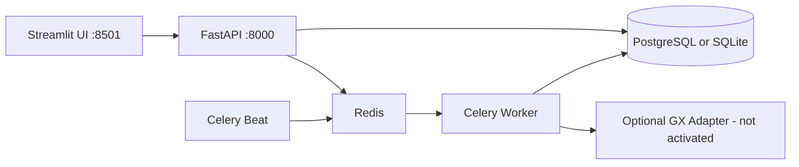

# Financial DQ Control Center — runnable MVP

An isolated, working prototype for the enterprise financial-DQ requirements. **This is not a production banking integration.** No existing enterprise tables or document pipeline are modified.

## Architecture



Separate `api/`, `ui/`, `common/`, and `worker/` Python packages communicate via REST, SQLAlchemy database sessions and Celery tasks. `common/` is importable by both API and worker, keeping calculation semantics in one place.

## Option A: Docker Compose (requires manual database provisioning)

Prerequisite: Docker Desktop with Compose. **Before starting API/worker, manually provision the 11 PostgreSQL tables with `sql/postgres_create_tables.sql` in an existing schema, using a DBA account. See the manual provisioning section below.**

```bash
docker compose up --build -d
docker compose ps
# Run the manual SQL script in the DB first, then restart API/worker if they failed startup.
```

Open:
- UI: http://localhost:8501
- API documentation: http://localhost:8000/docs
- Health: http://localhost:8000/health

Docker supplies PostgreSQL, Redis, API, UI, worker and periodic scheduler. Demo data/rules are seeded on first API startup. API requests from external clients require `X-API-Key: local-demo-key-change-me`.

Stop services with `docker compose down` (database retained); reset demo using `docker compose down -v` (deletes the local demo volume).

## Option B: Without Docker (SQLite + synchronous jobs; pre-created tables required)

Prerequisite: Python 3.11+.

Windows PowerShell:
```powershell
cd financial-dq-engine
py -m venv .venv
.venv\Scripts\Activate.ps1
pip install -r requirements.txt
$env:SEED_DEMO="true"
$env:EXECUTION_MODE="sync"
uvicorn api.main:app --reload --port 8000
```

Open a **second terminal** in the project folder, activate the same virtual environment, and run:
```powershell
$env:API_URL="http://localhost:8000"
streamlit run ui/app.py --server.port 8501
```

macOS/Linux:
```bash
python3 -m venv .venv
source .venv/bin/activate
pip install -r requirements.txt
SEED_DEMO=true EXECUTION_MODE=sync uvicorn api.main:app --reload --port 8000
# in a second activated terminal:
streamlit run ui/app.py --server.port 8501
```

SQLite mode requires you to provision the matching tables before first startup; it no longer auto-creates them. It executes requests synchronously and does **not** start a scheduler. For daily/monthly schedules, use Docker Compose.

## First end-to-end demo

1. Open **Rule Registry** and inspect the seeded `Rule_06` and `Rule_09`.
2. Open **Rule Orchestrator**, leave all rule selections blank, set reporting period `2026-12` and select portfolio `BANK`.
3. Click **Run validations**.
4. Open **Execution History**. Seed data causes ratio 5.8% to FAIL the `>=7%` limit, and revenue growth 70% to FAIL the >50% movement breach rule.
5. Open **DQ Reports** to download an Excel report.
6. In **Rule Builder**, create a rule, select CDE PRJ IDs, and configure threshold JSON. Creating a new version preserves earlier configs.
7. Use **Excel Rule Import** with a workbook having `Rule ID`, `PRJ ID`, and optional `Proposed Business Rule` columns. This previews draft mappings only.

## Example API calls

```bash
curl -H 'X-API-Key: local-demo-key-change-me' http://localhost:8000/api/v1/dq/rules
curl -X POST http://localhost:8000/api/v1/dq/executions \
  -H 'X-API-Key: local-demo-key-change-me' \
  -H 'Content-Type: application/json' \
  -d '{"rule_ids":["Rule_06","Rule_09"],"portfolio":"BANK","period":"2026-12"}'
```

Find all available endpoints at `/docs`.

## Existing database integration — deliberately not guessed

Production sources `cfv_attribute_masters`, `portfolio_refrence`, `prj_financials_v2`, and any AR/non-AR or CFI mappings **are not recreated or altered**. This demo uses `demo_cfv_attribute_masters`, `demo_portfolio_refrence` and `demo_normalized_financial_facts` because the real schema, column names, lineage keys and connection access are unknown. Adapt the SQLAlchemy data-access queries in `common/execution.py`, the registry queries in `api/main.py`, and the models in `common/models.py` to read approved views of your existing tables. Prefer read-only views/sessions. Populate DQ-owned tables only in a separate schema. Migrate with Alembic after review rather than calling `create_all` on an enterprise DB.

## Scope and limitations

Implemented: Rule CRUD with immutable config versions, many-to-many PRJ ID mapping, CDE eligibility checks at activation and runtime, portfolio applicability, limit/mandatory/data type/duplicate/enumeration/pattern/movement/comparison/reconciliation checks, scoped on-demand jobs, Celery worker, daily/monthly schedule dispatcher, results, Excel export, SMTP notification (when configured), simple dashboard, and draft Excel intake.

Not yet implemented: actual `prj_financials_v2` adapter, CFI crosswalk, original document lineage, GX Expectation execution, full Excel business-rule inference/approval workflow, SQL user rules, production auth/SSO/RBAC, safe arbitrary SQL query compilation, PDF generation, cross-table reconciliation, complex expressions, incremental large-scale pushdown and operational hardening. GX is an **integration option**, not claimed to execute in this MVP. A production deployment needs independent worker concurrency safeguards, audit trail of approvals, data snapshot consistency, cancellation, security review, reliable migrations, secrets handling, secured SMTP, and proper observability.

SQL rules are deliberately **not enabled** because evaluating free-form rules against real financial databases without a controlled SQL AST/allowlist is unsafe.

## Tests

```bash
pytest -q
```

## Technical considerations

- LIMIT: operator expresses PASS; MOVEMENT: operator expresses BREACH (flag when exceeded).
- `PREVIOUS_PERIOD` is defaulted to previous calendar year in this MVP; confirm your reporting calendar before production use.
- Current-year filtered records are evaluated against unfiltered historical demo records.
- CDE reclassification Y→N skips future checks without deleting historical rule versions or outcomes.
- Rows within a reporting period should be unique per company/portfolio/attribute/collection type, unless using the DUPLICATE rule; ambiguous movement predecessors are skipped.
- Schedules use UTC with one beat scheduler. Day-of-month is restricted to 1–28 for predictable monthly execution.
- Local Docker credentials and API key are development-only and must be replaced.

---

## Poetry-based installation and environment settings (v0.1.1)

**Poetry is now the dependency manager.** The API (`api/`), UI (`ui/`), shared services (`common/`), and background worker (`worker/`) remain separate Python modules and retain their existing behavior. Use the instructions in this section instead of the earlier `pip install -r requirements.txt` steps. `requirements.txt` is kept as a legacy reference only; `pyproject.toml` is the source of truth.

### 1. Prepare environment

Install Python 3.11 or 3.12 and Poetry 2.x; Docker Desktop is needed only for the Compose method.

```powershell
cd financial-dq-engine
Copy-Item .env.example .env -Force
poetry install
```

**Environment keys:**

| Key | Sample local value | Purpose |
|---|---|---|
| `ENABLE_POSTGRES` | `false` | `false` = SQLite demo; `true` = PostgreSQL |
| `PG_HOST` | `localhost` | PostgreSQL server; Compose sets internal hostname `postgres` |
| `PG_PORT` | `5432` | PostgreSQL port |
| `PG_DATABASE` | `dq` | Database name |
| `PG_SCHEMA` | `dq_app` | Dedicated schema for the DQ application's own tables |
| `POSTGRES_USER` | `dq` | PostgreSQL username |
| `POSTGRES_PASSWORD` | `dq_local_only` | Password; replace outside local demo |
| `POSTGRES_SSLMODE` | `prefer` | psycopg SSL mode (`require`/`verify-full` for deployed systems) |
| `EXECUTION_MODE` | `sync` | `sync` for local SQLite; `celery` with Redis worker |
| `SEED_DEMO` | `true` | Seed demonstration data when API initializes |

The `.env` file is loaded at application startup by `common/config.py`; Docker/runtime environment overrides the file. `DATABASE_URL` is **not used** anymore to select the SQLAlchemy connection. Passwords containing URL special characters are safely encoded.

When PostgreSQL is enabled, SQLAlchemy uses a connection with a search path of `PG_SCHEMA,public`. `init_db()` checks that all demo/DQ tables already exist and have required columns; it **never executes schema or table creation**. **Do not point this prototype directly at a production PostgreSQL instance.** Provide separate least-privilege read-only access to the original financial tables.

### 2. Run locally on SQLite (requires pre-provisioned tables)

Set `ENABLE_POSTGRES=false`, `EXECUTION_MODE=sync` in `.env`. From the project folder, run in **terminal A**:

```powershell
poetry run uvicorn api.main:app --reload --port 8000
```

In **terminal B**:

```powershell
poetry run streamlit run ui/app.py --server.port 8501
```

Open `http://localhost:8501` for UI and `http://localhost:8000/docs` for API. For Python tests:

```powershell
poetry run pytest -q
```

### 3. Run with PostgreSQL directly (without Docker for API/UI)

Use an existing PostgreSQL database and schema. Have your DBA execute `sql/postgres_create_tables.sql` in that schema before startup. The application user does not require CREATE permissions. Edit `.env`:

```dotenv
ENABLE_POSTGRES=true
PG_HOST=localhost
PG_PORT=5432
PG_DATABASE=dq
PG_SCHEMA=dq_app
POSTGRES_USER=dq
POSTGRES_PASSWORD=replace_this
POSTGRES_SSLMODE=prefer
EXECUTION_MODE=sync
```

Then run the same two `poetry run` commands above. Note: `PG_SCHEMA` must be a safe dedicated identifier; the application expects its manually provisioned tables to exist in that schema.

For distributed validation/scheduling, start Redis and the Celery worker/beat separately; set `EXECUTION_MODE=celery` and `REDIS_URL` appropriately:

```powershell
poetry run celery -A worker.tasks.celery_app worker --loglevel=info
poetry run celery -A worker.tasks.celery_app beat --loglevel=info
```

### 4. Run all services through Docker Compose

```powershell
Copy-Item .env.example .env -Force
# Replace the sample password and API key in .env for anything beyond local demo.
docker compose up --build -d
docker compose ps
# Run the manual SQL script in the DB first, then restart API/worker if they failed startup.
```

Compose uses `ENABLE_POSTGRES=true` and `PG_HOST=postgres` **inside the API and worker containers**, while exposing PostgreSQL on localhost at `PG_PORT` for external tools. Other `PG_*` values and the API key are taken from `.env` and shared consistently. The worker and scheduler use the same settings. **Compose uses Poetry for dependency installation and all Python commands.**

```powershell
docker compose logs -f api
docker compose down
```

Be careful with `docker compose down -v`: it deletes the demo PostgreSQL volume. If your existing database volume was created with a different `POSTGRES_USER`/`PG_DATABASE`, changing these environment variables does **not** migrate the already initialized volume; change credentials/DB explicitly using PostgreSQL administration commands.

### 5. Optional Great Expectations group

```powershell
poetry install --with gx
```

GX is optional and **not wired into active rule execution** in this MVP. The original validation engine continues to operate unchanged.

### 6. Lockfile and environment verification

A `poetry.lock` cannot be generated in an offline environment without Poetry/dependency index access. On the first connected developer machine, run `poetry lock` and commit the generated `poetry.lock` for reproducible team deployments. Until then Docker resolves versions from `pyproject.toml` at build time.

```powershell
poetry check
poetry lock
poetry install
poetry run pytest -q
```

## Database startup / `OperationalError: no such column` troubleshooting

Tables must now be manually provisioned. `init_db()` **only validates** the existing schema. Run `sql/postgres_create_tables.sql` as a DBA in your existing `PG_SCHEMA` before starting FastAPI. If a table already exists but lacks columns, the app fails with a clear compatibility message; `CREATE TABLE IF NOT EXISTS` does not upgrade such a table. Review and apply an explicit migration, without dropping production data.

The expected demo attribute table is `demo_cfv_attribute_masters` with `prj_id` (not `demo_prj_attribute_masters` / `_pri_id`). For SQLite, the table schema must also be provisioned separately; pointing to a fresh SQLite file alone is no longer sufficient.

**Changed files for manual provisioning:** `common/database.py`, `sql/postgres_create_tables.sql`, `.env.example`, `tests/test_schema_compatibility.py`, `README.md`, `ARCHITECTURE.md`. Core rule handlers, API routes, UI and worker tasks remain unchanged.

## Manual PostgreSQL table provisioning (restricted database accounts)

**This deployment never executes `CREATE SCHEMA`, `CREATE TABLE`, or `ALTER TABLE` on application startup.** Provision once as a DBA, before starting the API/worker. The existing `PG_DATABASE` and `PG_SCHEMA` must exist. No schema or existing production tables are created or modified by the application.

1. Ask your DBA to review `sql/postgres_create_tables.sql`. Change its first `SET search_path TO dq_app, public;` to the **existing** schema specified in `.env` as `PG_SCHEMA`. The script has **11 demo/DQ tables**, primary/foreign keys and indexes, but **no `CREATE SCHEMA`**.
2. Run the SQL script in the target database using your database management tool (or `psql -h HOST -p PORT -U USER -d DATABASE -v ON_ERROR_STOP=1 -f sql/postgres_create_tables.sql`). This step needs **CREATE permission on the existing schema**; if you lack that permission, your DBA must run it.
3. Grant the application account USAGE on the existing schema and SELECT/INSERT/UPDATE/DELETE on the DQ/demo tables plus USAGE/SELECT on any generated sequences, subject to your institution's privilege policy. Example SQL (to be reviewed and run by a DBA):

   ```sql
   GRANT USAGE ON SCHEMA dq_app TO dq_app_user;
   GRANT SELECT, INSERT, UPDATE, DELETE ON ALL TABLES IN SCHEMA dq_app TO dq_app_user;
   GRANT USAGE, SELECT ON ALL SEQUENCES IN SCHEMA dq_app TO dq_app_user;
   ```

   Replace `dq_app` and `dq_app_user`; narrow privileges in production. No CREATE permission is needed for normal app startup.
4. Configure `.env`: `ENABLE_POSTGRES=true`, `PG_HOST`, `PG_PORT`, `PG_DATABASE`, `PG_SCHEMA`, `POSTGRES_USER`, `POSTGRES_PASSWORD`, `POSTGRES_SSLMODE=prefer`.
5. Run `poetry install`, then `poetry run uvicorn api.main:app --reload --port 8000`. Open a second terminal and run `poetry run streamlit run ui/app.py --server.port 8501`.
6. `SEED_DEMO=true` inserts **demo test data** into your manually created demo/DQ tables. Set `SEED_DEMO=false` to disable demo inserts. This setting does not change table provisioning.

**Note for SQLite users:** Automatic SQLite table creation has also been disabled. If you need the legacy self-contained SQLite demo, provision its tables separately in a local disposable database; PostgreSQL manual provisioning is the supported path for this package.

**Do not run the script against real `cfv_attribute_masters`, `portfolio_refrence`, or `prj_financials_v2`.** The application still uses isolated `demo_*` tables pending production adapter integration. `CREATE TABLE IF NOT EXISTS` does not repair older incompatible layouts; startup fails safely in that case.
