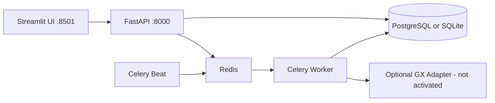

# Financial DQ Engine v0.2.0 — Swagger, thresholds and SCD Type 2 audit

> **Database safety:** All database schema changes are DBA-operated SQL scripts; the API and UI never issue `CREATE SCHEMA`, `CREATE TABLE`, `ALTER TABLE` or a migration. Existing `prj_attribute_master` and `prj_portfolio_reference` are always read-only. This remains a demo-financial-facts MVP, **not** the production `prj_financials_v2` data adapter.

## Update an existing PostgreSQL installation (required before starting API)

1. Back up the `dq_rule_versions` table and confirm your `.env` `PG_SCHEMA`.
2. Review **`sql/postgres_migrate_threshold_scd2.sql`**, replace `dq_app` with your existing schema, and execute it **manually as an authorized DBA**. This adds threshold and SCD2 fields to the **existing DQ-owned `dq_rule_versions` table only**, backfills current config thresholds and version intervals, and creates a partial unique index on the current version. Existing reference masters, facts, result records and other DQ tables are untouched.
3. For an **entirely new deployment only**, use the revised `sql/postgres_create_tables.sql` instead. **Do not rerun CREATE TABLE on an existing deployment expecting it to add columns**.
4. Existing version metadata predating this change cannot perfectly reconstruct historical names/statuses; the backfill uses the existing rule's current name/status for those snapshots. Historical threshold values are recovered from each version's original JSON when numeric. Going forward every change is captured as SCD2.
5. Keep your existing `.env` settings (never copy the placeholder password from `.env.example` onto your real configuration).

Run from the project root (PowerShell):

```powershell
poetry install
poetry run pytest -q
poetry run uvicorn api.main:app --reload --host 127.0.0.1 --port 8000
```

In a **second** PowerShell terminal, run:

```powershell
poetry run streamlit run ui/app.py --server.port 8501
```

Visit **http://localhost:8000/docs** (not `http://localhost/docs`, which defaults to port 80), **http://localhost:8000/openapi.json**, and **http://localhost:8000/api-reference** (CDN-free route listing). If Swagger cannot load JavaScript from its CDN on a restricted corporate network, the CDN-free route listing shows what is actually registered. Verify `/openapi.json` contains `/api/v1/dq/rules` and `/api/v1/dq/rules/{rule_id}/audit`. Swagger's **Authorize** expects your `.env` `DQ_API_KEY`; the route catalogue `/api-reference` is public and shows only documented route names.

## Rule Builder — threshold semantics

Rule Builder now shows **Threshold Value**, **Threshold Type**, **Changed by**, and **Change reason** above the rule's JSON configuration. The API accepts `threshold_value` and `threshold_type` in `config`, and optional top-level fields in `RuleInput`. Values support decimals (e.g. `1`, `1.1`, `7`, `50`). Legacy `config.threshold` remains supported and is normalized to `threshold_value`; the saved immutable version includes both.

- `PERCENTAGE`: for a `LIMIT`, a financial fact stored with `unit=PERCENT` compares `1.1` to 1.1%; a fact stored with `unit=FRACTION` first multiplies its value by 100. Other units are skipped as incompatible, never silently interpreted. A `MOVEMENT` threshold is always a percentage **breach** (e.g. movement > 50% FAILS).
- `AMOUNT`: limit compares the financial fact directly against the numeric threshold; values are evaluated with `Decimal`.
- `COUNT`: `DUPLICATE` compares the number of equal company/portfolio/PRJ/period/collection-type records to a count threshold; default is **at most 1**. Existing duplicate checks remain equivalent.
- `LIMIT` operators specify the **passing condition** (example `>= 1.1`). `MOVEMENT` operators specify the **breach condition** (example `> 50` triggers FAIL). Don't mix these meanings.

Example create via Swagger `POST /api/v1/dq/rules` (replace `PRJ105` with a real `is_cde=true` PRJ ID):

```json
{
  "id":"RULE_PCT_11",
  "name":"Capital Ratio not below 1.1 percent",
  "rule_type":"LIMIT",
  "status":"ACTIVE",
  "severity":"HIGH",
  "targets":["PRJ105"],
  "portfolios":[],
  "config":{"operator":">=","threshold_value":"1.1","threshold_type":"PERCENTAGE","require_cde":true},
  "changed_by":"demo-user",
  "change_reason":"Initial threshold setup"
}
```

## Rule audit (SCD Type 2)

- `GET /api/v1/dq/rules/{rule_id}/audit`: all versions with `effective_from`, `effective_to`, `is_current`, `status`, `threshold_value`, `threshold_type`, `changed_by`, and `change_reason`.
- `GET /api/v1/dq/rules/{rule_id}/versions`: the same SCD2 history with full immutable configuration, targets, portfolios and threshold fields.
- Rule edits, activation and deactivation **close the old row and add a new version**. No new history entry is created for a redundant status change. Previous version configurations and execution-time result snapshots remain available.
- The API accepts a user-supplied `changed_by` for demonstration; use authenticated SSO identity for audit reliability in production.
- The Rule Registry UI includes an **SCD Type 2 audit history** view.

### Files changed in this update

- `api/main.py` — route catalogue, audit endpoint, Swagger documentation metadata, status transition history.
- `ui/app.py` — threshold input fields, change reason, SCD2 history, Swagger links.
- `common/schemas.py` — typed threshold validation with legacy support.
- `common/models.py` — SCD2 and threshold columns on `dq_rule_versions`.
- `common/services.py` — SCD2 transitions for rule edits and status changes.
- `common/execution.py` — threshold type-aware financial checks and configurable count threshold.
- `common/reporting.py` — threshold metadata in reports.
- `common/seed.py` — explicit sample percentage threshold fields for new demos.
- `sql/postgres_create_tables.sql` — DDL for fresh installations.
- `sql/postgres_migrate_threshold_scd2.sql` — **manual migration for existing installations**.
- `tests/test_threshold_scd2.py` — threshold and SCD2 regression tests.
- `pyproject.toml`, `README.md`, `ARCHITECTURE.md` — version and docs.

---

## Fix: `ModuleNotFoundError: No module named common` (Streamlit + Poetry)

The Streamlit CLI runs `ui/app.py` with `ui/` as its import directory, while
`common/` is a sibling package. `ui/app.py` now inserts the **absolute project root**
into `sys.path` before `import common.config`, regardless of PowerShell's
current directory. `common.config` loads the project's `.env` before the UI reads
`API_URL` and `DQ_API_KEY`, without overriding explicitly configured environment
variables. This is a UI startup fix only: no API, rule, SQL or database logic changed.

1. Replace `ui/app.py` with the file in the new ZIP, or extract the new ZIP
   over the application folder (retain your private `.env`).
2. In the extracted folder containing `pyproject.toml`, run:

   ```powershell
   poetry install
   poetry run uvicorn api.main:app --reload --port 8000
   ```

3. In another PowerShell terminal, same project folder:

   ```powershell
   poetry run streamlit run ui/app.py --server.port 8501
   ```

4. Open `http://localhost:8501` and `http://localhost:8000/docs`.
   If the API returns 401, confirm `DQ_API_KEY` in your `.env` matches the API
   process. If the API cannot connect, confirm `API_URL=http://localhost:8000`.

No database schema creation or migration is performed. Existing PRJ master
references, DQ tables, and all existing features are preserved.

**Changed files:** `ui/app.py`, `tests/test_ui_import.py`, `README.md`.

---

# Financial DQ Control Center — runnable MVP

## Swagger endpoint visibility + demo seed (v0.1.2)

Swagger UI: **http://127.0.0.1:8000/docs**. The DQ endpoints are grouped under
Dashboard, Rule management, Rule types, Attributes & portfolios, Execution & results,
Scheduling, Reporting, and Demo. Click **Authorize** in Swagger and enter the exact
`DQ_API_KEY` from `.env` (default in `.env.example`: `local-demo-key-change-me`).
The UI imports `common.config` so the `.env` API key is loaded on Poetry local starts.

**If Swagger says “No operations defined in spec”:** open
`http://127.0.0.1:8000/openapi.json`. It must contain a nonempty `paths` object
including `/api/v1/dq/rules`. If it does not, stop old Uvicorn instances,
run from the extracted project directory containing `pyproject.toml`, and restart
`poetry run uvicorn api.main:app --reload --host 127.0.0.1 --port 8000`.
If `/openapi.json` returns an error, check the browser developer console and FastAPI
terminal logs. Do not use another service or port by accident.

### Seed sample financial facts and rules safely

1. In a **development** `.env`, set `SEED_DEMO=true`, `EXECUTION_MODE=sync`,
   `ENABLE_POSTGRES=true`, and the requested PG connection variables.
2. Manually provision DQ tables using `sql/postgres_create_tables.sql` in your
   **existing** schema. The API never runs `CREATE SCHEMA`, `CREATE TABLE`, or `ALTER`.
3. Existing `prj_attribute_master` must contain at least **two** eligible
   `is_cde='Y'` attributes. Existing `prj_portfolio_reference` must contain an
   active portfolio. They are *never* created or modified by the seeder.
4. Start FastAPI. Startup seeds the sample automatically if enabled. Alternatively,
   in Swagger click **POST /api/v1/dq/demo/seed → Try it out → Execute**, or use the
   **Seed sample DQ records** button on the Streamlit Dashboard. You can also run:

   ```powershell
   poetry run python -m common.seed
   ```

5. Call **GET /api/v1/dq/demo/status** to check the selected PRJ IDs, portfolio,
   and demo fact count. The sample uses document ID `DEMO-001`, reporting periods
   `2025-12` and `2026-12`, and company `DQ Sample Company`. The exact portfolio
   code is chosen from your active portfolio records, **not hardcoded to BANK**.
6. Sample rules: `Rule_06` checks 5.8% against a minimum of 7%; `Rule_09` checks
   revenue moving from 100 to 170 against a 50% movement limit. With two eligible
   CDEs, the sample run `DEMO-SEED-RUN` produces **two FAIL results**.
7. Navigate to **Execution History** and inspect `DEMO-SEED-RUN`, then open
   **DQ Reports** and download the Excel report. To run again, use
   **POST /api/v1/dq/executions** with `{"period":"2026-12","portfolio":"<selected-code>"}`.

The seed operation is **idempotent** and inserts into DQ-owned and demo-fact tables
only. An existing `Rule_06` or `Rule_09` is not overwritten. If those IDs already
exist with different logic, use their actual definitions to interpret outcomes.
Set `SEED_DEMO=false` to disable the seed endpoint (HTTP 403); do not enable it in production.
The demo still reads `demo_normalized_financial_facts`, not `prj_financials_v2`.

**Changed files:** `api/main.py` (explicit OpenAPI auth, categorized endpoints,
demo status and seed APIs), `ui/app.py` (local `.env` loading and seed UI),
`common/seed.py` (idempotent demo-document detection),
`tests/test_swagger_and_demo.py` (Swagger/auth/seed/report regression tests),
and `README.md`. All existing rule evaluation handlers, SQLAlchemy DQ models,
reporting, endpoints, and manually managed database DDL remain intact.

---


An isolated, working prototype for the enterprise financial-DQ requirements. **This is not a production banking integration.** No existing enterprise tables or document pipeline are modified.


## Fix for existing tables missing `prj_id` (manual DBA migration)

If startup lists `demo_normalized_financial_facts`, `dq_rule_cde_mapping`, or
`dq_validation_results` as missing `prj_id`, the tables **already exist** but
their physical layouts differ from the ORM. `CREATE TABLE IF NOT EXISTS`
does **not** repair an existing table. No application SQL performs DDL.

1. Run `sql/postgres_inspect_prj_id.sql` in your SQL editor, replacing
   `dq_app` with the exact schema in `PG_SCHEMA`. This script only reads
   `information_schema` and shows all actual columns.
2. If the actual business-ID column is called `pri_id` (or another typo),
   verify its values, then use the **commented DBA-reviewed statements**
   in `sql/postgres_repair_prj_id.sql` to rename it to `prj_id`. Uncomment
   only the specific tables with that confirmed typo. The application
   never executes this repair.
3. If the actual column is absent altogether, obtain a verified source
   mapping for backfill before adding it. Do not add an empty column
   blindly: it would corrupt rule targeting and result lineage.
4. Restart FastAPI after the DBA applies the reviewed change.

The corrected schema check now lists both missing **and existing** columns
for each incompatible table, making the mismatch actionable. The two
existing PRJ master tables remain read-only and unchanged.

## Existing PRJ masters — read-only (2026-11-23 update)

The API, Rule Builder and executor now read **existing** `prj_attribute_master` and
`prj_portfolio_reference` tables. They are **never** created, altered, or seeded by
this application. The app uses SQLAlchemy reflection; for the attribute master it
requires `prj_id`, `is_cde`; for the portfolio master it requires `short_code`,
`portfolio_name`, `is_active` (case-insensitive names). Optional recognized fields
include `attribute_name` / `prj_item_name` / `name` / `description`, `cfi_id`,
`sector_name`, `sub_sector`, and `document_type_id`.

The data connection's `PG_SCHEMA` must refer to the **existing schema containing
both PRJ reference tables and the DQ tables**; otherwise startup reports missing
tables. A different-schema setup needs a read-only view or a later adapter extension.

**Provision once, manually:** Execute `sql/postgres_create_tables.sql` in your
existing `PG_SCHEMA` as a suitably authorized DBA. This script creates only 8
DQ-owned tables and `demo_normalized_financial_facts` (9 total: 8 DQ + 1 demo).
It does not create schemas or the two existing PRJ reference tables. Run it
only when the DQ tables do not already exist; `IF NOT EXISTS` does not fix
incompatible pre-existing column layouts.

**Optional seed:** Set `SEED_DEMO=true` only in a non-production environment
and restart the API, or run `poetry run python -m common.seed`. Seeding uses
up to two **existing eligible PRJ IDs** and one active portfolio code; it never
inserts/updates the PRJ master rows. It inserts example records in
`demo_normalized_financial_facts`, sample rules/versions/mappings, a disabled
schedule, a draft import batch and a completed sample execution with validation
results. It is idempotent; notification history is not faked. `SEED_DEMO=false`
is recommended for enterprise databases.

The application still validates **demo_normalized_financial_facts**, not actual
`prj_financials_v2`. Mapping the latter requires its confirmed layout and
lineage keys; no change to ETL has been made. The rest of the DQ UI/API and
rule execution logic remains in place.

### Run with Poetry and your existing PostgreSQL schema

```powershell
# Copy .env.example to .env and set ENABLE_POSTGRES=true plus
# PG_HOST, PG_PORT, PG_DATABASE, PG_SCHEMA, POSTGRES_USER,
# POSTGRES_PASSWORD, POSTGRES_SSLMODE=prefer.
poetry install
poetry run uvicorn api.main:app --reload --port 8000
# In another terminal:
poetry run streamlit run ui/app.py --server.port 8501
```

Before starting, have a DBA execute `sql/postgres_create_tables.sql` in the
existing schema. No `CREATE SCHEMA` permissions are needed by the runtime.

## Architecture



Separate `api/`, `ui/`, `common/`, and `worker/` Python packages communicate via REST, SQLAlchemy database sessions and Celery tasks. `common/` is importable by both API and worker, keeping calculation semantics in one place.

## Option A: Docker Compose (requires manual database provisioning)

Prerequisite: Docker Desktop with Compose. **Before starting API/worker, manually provision the 9 DQ-owned/demo-facts tables with `sql/postgres_create_tables.sql` in an existing schema, using a DBA account. See the manual provisioning section below.**

```bash
docker compose up --build -d
docker compose ps
# Run the manual SQL script in the DB first, then restart API/worker if they failed startup.
```

Open:
- UI: http://localhost:8501
- API documentation: http://localhost:8000/docs
- Health: http://localhost:8000/health

Docker supplies PostgreSQL, Redis, API, UI, worker and periodic scheduler. Demo data/rules are seeded only when `SEED_DEMO=true`, and existing PRJ masters must contain eligible attributes and an active portfolio. API requests from external clients require `X-API-Key: local-demo-key-change-me`.

Stop services with `docker compose down` (database retained); reset demo using `docker compose down -v` (deletes the local demo volume).

## Option B: Without Docker (SQLite + synchronous jobs; pre-created tables required)

Prerequisite: Python 3.11+.

Windows PowerShell:
```powershell
cd financial-dq-engine
py -m venv .venv
.venv\Scripts\Activate.ps1
pip install -r requirements.txt
$env:SEED_DEMO="true"
$env:EXECUTION_MODE="sync"
uvicorn api.main:app --reload --port 8000
```

Open a **second terminal** in the project folder, activate the same virtual environment, and run:
```powershell
$env:API_URL="http://localhost:8000"
streamlit run ui/app.py --server.port 8501
```

macOS/Linux:
```bash
python3 -m venv .venv
source .venv/bin/activate
pip install -r requirements.txt
SEED_DEMO=true EXECUTION_MODE=sync uvicorn api.main:app --reload --port 8000
# in a second activated terminal:
streamlit run ui/app.py --server.port 8501
```

SQLite mode requires you to provision the matching tables before first startup; it no longer auto-creates them. It executes requests synchronously and does **not** start a scheduler. For daily/monthly schedules, use Docker Compose.

## First end-to-end demo

1. Open **Rule Registry** and inspect the seeded `Rule_06` and `Rule_09`.
2. Open **Rule Orchestrator**, leave all rule selections blank, set reporting period `2026-12` and select portfolio `BANK`.
3. Click **Run validations**.
4. Open **Execution History**. Seed data causes ratio 5.8% to FAIL the `>=7%` limit, and revenue growth 70% to FAIL the >50% movement breach rule.
5. Open **DQ Reports** to download an Excel report.
6. In **Rule Builder**, create a rule, select CDE PRJ IDs, and configure threshold JSON. Creating a new version preserves earlier configs.
7. Use **Excel Rule Import** with a workbook having `Rule ID`, `PRJ ID`, and optional `Proposed Business Rule` columns. This previews draft mappings only.

## Example API calls

```bash
curl -H 'X-API-Key: local-demo-key-change-me' http://localhost:8000/api/v1/dq/rules
curl -X POST http://localhost:8000/api/v1/dq/executions \
  -H 'X-API-Key: local-demo-key-change-me' \
  -H 'Content-Type: application/json' \
  -d '{"rule_ids":["Rule_06","Rule_09"],"portfolio":"BANK","period":"2026-12"}'
```

Find all available endpoints at `/docs`.

## Existing database integration — deliberately not guessed

Existing sources `prj_attribute_master`, `prj_portfolio_reference` and `prj_financials_v2` are not recreated or altered. The first two are now used read-only through `common/reference_data.py`; only `demo_normalized_financial_facts` is still an isolated sample facts table. Adapt the SQLAlchemy data-access queries in `common/execution.py`, the registry queries in `api/main.py`, and the models in `common/models.py` to read approved views of your existing tables. Prefer read-only views/sessions. Populate DQ-owned tables only in a separate schema. Migrate with Alembic after review rather than calling `create_all` on an enterprise DB.

## Scope and limitations

Implemented: Rule CRUD with immutable config versions, many-to-many PRJ ID mapping, CDE eligibility checks at activation and runtime, portfolio applicability, limit/mandatory/data type/duplicate/enumeration/pattern/movement/comparison/reconciliation checks, scoped on-demand jobs, Celery worker, daily/monthly schedule dispatcher, results, Excel export, SMTP notification (when configured), simple dashboard, and draft Excel intake.

Not yet implemented: actual `prj_financials_v2` adapter, CFI crosswalk, original document lineage, GX Expectation execution, full Excel business-rule inference/approval workflow, SQL user rules, production auth/SSO/RBAC, safe arbitrary SQL query compilation, PDF generation, cross-table reconciliation, complex expressions, incremental large-scale pushdown and operational hardening. GX is an **integration option**, not claimed to execute in this MVP. A production deployment needs independent worker concurrency safeguards, audit trail of approvals, data snapshot consistency, cancellation, security review, reliable migrations, secrets handling, secured SMTP, and proper observability.

SQL rules are deliberately **not enabled** because evaluating free-form rules against real financial databases without a controlled SQL AST/allowlist is unsafe.

## Tests

```bash
pytest -q
```

## Technical considerations

- LIMIT: operator expresses PASS; MOVEMENT: operator expresses BREACH (flag when exceeded).
- `PREVIOUS_PERIOD` is defaulted to previous calendar year in this MVP; confirm your reporting calendar before production use.
- Current-year filtered records are evaluated against unfiltered historical demo records.
- CDE reclassification Y→N skips future checks without deleting historical rule versions or outcomes.
- Rows within a reporting period should be unique per company/portfolio/attribute/collection type, unless using the DUPLICATE rule; ambiguous movement predecessors are skipped.
- Schedules use UTC with one beat scheduler. Day-of-month is restricted to 1–28 for predictable monthly execution.
- Local Docker credentials and API key are development-only and must be replaced.

---

## Poetry-based installation and environment settings (v0.1.1)

**Poetry is now the dependency manager.** The API (`api/`), UI (`ui/`), shared services (`common/`), and background worker (`worker/`) remain separate Python modules and retain their existing behavior. Use the instructions in this section instead of the earlier `pip install -r requirements.txt` steps. `requirements.txt` is kept as a legacy reference only; `pyproject.toml` is the source of truth.

### 1. Prepare environment

Install Python 3.11 or 3.12 and Poetry 2.x; Docker Desktop is needed only for the Compose method.

```powershell
cd financial-dq-engine
Copy-Item .env.example .env -Force
poetry install
```

**Environment keys:**

| Key | Sample local value | Purpose |
|---|---|---|
| `ENABLE_POSTGRES` | `false` | `false` = SQLite demo; `true` = PostgreSQL |
| `PG_HOST` | `localhost` | PostgreSQL server; Compose sets internal hostname `postgres` |
| `PG_PORT` | `5432` | PostgreSQL port |
| `PG_DATABASE` | `dq` | Database name |
| `PG_SCHEMA` | `dq_app` | Dedicated schema for the DQ application's own tables |
| `POSTGRES_USER` | `dq` | PostgreSQL username |
| `POSTGRES_PASSWORD` | `dq_local_only` | Password; replace outside local demo |
| `POSTGRES_SSLMODE` | `prefer` | psycopg SSL mode (`require`/`verify-full` for deployed systems) |
| `EXECUTION_MODE` | `sync` | `sync` for local SQLite; `celery` with Redis worker |
| `SEED_DEMO` | `true` | Seed demonstration data when API initializes |

The `.env` file is loaded at application startup by `common/config.py`; Docker/runtime environment overrides the file. `DATABASE_URL` is **not used** anymore to select the SQLAlchemy connection. Passwords containing URL special characters are safely encoded.

When PostgreSQL is enabled, SQLAlchemy uses a connection with a search path of `PG_SCHEMA,public`. `init_db()` checks that all demo/DQ tables already exist and have required columns; it **never executes schema or table creation**. **Do not point this prototype directly at a production PostgreSQL instance.** Provide separate least-privilege read-only access to the original financial tables.

### 2. Run locally on SQLite (requires pre-provisioned tables)

Set `ENABLE_POSTGRES=false`, `EXECUTION_MODE=sync` in `.env`. From the project folder, run in **terminal A**:

```powershell
poetry run uvicorn api.main:app --reload --port 8000
```

In **terminal B**:

```powershell
poetry run streamlit run ui/app.py --server.port 8501
```

Open `http://localhost:8501` for UI and `http://localhost:8000/docs` for API. For Python tests:

```powershell
poetry run pytest -q
```

### 3. Run with PostgreSQL directly (without Docker for API/UI)

Use an existing PostgreSQL database and schema. Have your DBA execute `sql/postgres_create_tables.sql` in that schema before startup. The application user does not require CREATE permissions. Edit `.env`:

```dotenv
ENABLE_POSTGRES=true
PG_HOST=localhost
PG_PORT=5432
PG_DATABASE=dq
PG_SCHEMA=dq_app
POSTGRES_USER=dq
POSTGRES_PASSWORD=replace_this
POSTGRES_SSLMODE=prefer
EXECUTION_MODE=sync
```

Then run the same two `poetry run` commands above. Note: `PG_SCHEMA` must be a safe dedicated identifier; the application expects its manually provisioned tables to exist in that schema.

For distributed validation/scheduling, start Redis and the Celery worker/beat separately; set `EXECUTION_MODE=celery` and `REDIS_URL` appropriately:

```powershell
poetry run celery -A worker.tasks.celery_app worker --loglevel=info
poetry run celery -A worker.tasks.celery_app beat --loglevel=info
```

### 4. Run all services through Docker Compose

```powershell
Copy-Item .env.example .env -Force
# Replace the sample password and API key in .env for anything beyond local demo.
docker compose up --build -d
docker compose ps
# Run the manual SQL script in the DB first, then restart API/worker if they failed startup.
```

Compose uses `ENABLE_POSTGRES=true` and `PG_HOST=postgres` **inside the API and worker containers**, while exposing PostgreSQL on localhost at `PG_PORT` for external tools. Other `PG_*` values and the API key are taken from `.env` and shared consistently. The worker and scheduler use the same settings. **Compose uses Poetry for dependency installation and all Python commands.**

```powershell
docker compose logs -f api
docker compose down
```

Be careful with `docker compose down -v`: it deletes the demo PostgreSQL volume. If your existing database volume was created with a different `POSTGRES_USER`/`PG_DATABASE`, changing these environment variables does **not** migrate the already initialized volume; change credentials/DB explicitly using PostgreSQL administration commands.

### 5. Optional Great Expectations group

```powershell
poetry install --with gx
```

GX is optional and **not wired into active rule execution** in this MVP. The original validation engine continues to operate unchanged.

### 6. Lockfile and environment verification

A `poetry.lock` cannot be generated in an offline environment without Poetry/dependency index access. On the first connected developer machine, run `poetry lock` and commit the generated `poetry.lock` for reproducible team deployments. Until then Docker resolves versions from `pyproject.toml` at build time.

```powershell
poetry check
poetry lock
poetry install
poetry run pytest -q
```

## Database startup / `OperationalError: no such column` troubleshooting

Tables must now be manually provisioned. `init_db()` **only validates** the existing schema. Run `sql/postgres_create_tables.sql` as a DBA in your existing `PG_SCHEMA` before starting FastAPI. If a table already exists but lacks columns, the app fails with a clear compatibility message; `CREATE TABLE IF NOT EXISTS` does not upgrade such a table. Review and apply an explicit migration, without dropping production data.

The existing required attribute table is `prj_attribute_master` with `prj_id` and `is_cde`. For SQLite, the table schema must also be provisioned separately; pointing to a fresh SQLite file alone is no longer sufficient.

**Changed files for manual provisioning:** `common/database.py`, `sql/postgres_create_tables.sql`, `.env.example`, `tests/test_schema_compatibility.py`, `README.md`, `ARCHITECTURE.md`. Core rule handlers, API routes, UI and worker tasks remain unchanged.

## Manual PostgreSQL table provisioning (restricted database accounts)

**This deployment never executes `CREATE SCHEMA`, `CREATE TABLE`, or `ALTER TABLE` on application startup.** Provision once as a DBA, before starting the API/worker. The existing `PG_DATABASE` and `PG_SCHEMA` must exist. No schema or existing production tables are created or modified by the application.

1. Ask your DBA to review `sql/postgres_create_tables.sql`. Change its first `SET search_path TO dq_app, public;` to the **existing** schema specified in `.env` as `PG_SCHEMA`. The script has **11 demo/DQ tables**, primary/foreign keys and indexes, but **no `CREATE SCHEMA`**.
2. Run the SQL script in the target database using your database management tool (or `psql -h HOST -p PORT -U USER -d DATABASE -v ON_ERROR_STOP=1 -f sql/postgres_create_tables.sql`). This step needs **CREATE permission on the existing schema**; if you lack that permission, your DBA must run it.
3. Grant the application account USAGE on the existing schema and SELECT/INSERT/UPDATE/DELETE on the DQ/demo tables plus USAGE/SELECT on any generated sequences, subject to your institution's privilege policy. Example SQL (to be reviewed and run by a DBA):

   ```sql
   GRANT USAGE ON SCHEMA dq_app TO dq_app_user;
   GRANT SELECT, INSERT, UPDATE, DELETE ON ALL TABLES IN SCHEMA dq_app TO dq_app_user;
   GRANT USAGE, SELECT ON ALL SEQUENCES IN SCHEMA dq_app TO dq_app_user;
   ```

   Replace `dq_app` and `dq_app_user`; narrow privileges in production. No CREATE permission is needed for normal app startup.
4. Configure `.env`: `ENABLE_POSTGRES=true`, `PG_HOST`, `PG_PORT`, `PG_DATABASE`, `PG_SCHEMA`, `POSTGRES_USER`, `POSTGRES_PASSWORD`, `POSTGRES_SSLMODE=prefer`.
5. Run `poetry install`, then `poetry run uvicorn api.main:app --reload --port 8000`. Open a second terminal and run `poetry run streamlit run ui/app.py --server.port 8501`.
6. `SEED_DEMO=true` inserts **demo test data** into your manually created demo/DQ tables. Set `SEED_DEMO=false` to disable demo inserts. This setting does not change table provisioning.

**Note for SQLite users:** Automatic SQLite table creation has also been disabled. If you need the legacy self-contained SQLite demo, provision its tables separately in a local disposable database; PostgreSQL manual provisioning is the supported path for this package.

**Do not run the script against real `cfv_attribute_masters`, `portfolio_refrence`, or `prj_financials_v2`.** The application still uses isolated `demo_*` tables pending production adapter integration. `CREATE TABLE IF NOT EXISTS` does not repair older incompatible layouts; startup fails safely in that case.

## PostgreSQL BOOLEAN `is_cde` compatibility fix

`prj_attribute_master.is_cde` may be a PostgreSQL `BOOLEAN` (`TRUE`/`FALSE`) or a legacy text field (`Y`/`N`). `common/reference_data.py` now uses SQLAlchemy's reflected column type to bind actual booleans for boolean columns, while consistently returning `Y`/`N` to existing API consumers and DQ validation logic. No SQL DDL or migration is required. Restart the FastAPI service after replacing the project files. Test with `GET /api/v1/dq/attributes?is_cde=Y` and `?is_cde=N` in Swagger.
